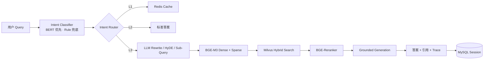

# FiberMind

项目描述与可验证指标见 [`docs/project-description.md`](docs/project-description.md)，完整对齐
审计见 [`reports/alignment-report.md`](reports/alignment-report.md)。

面向光网络运维的可解释 RAG 故障诊断系统。系统把请求依次送入意图识别、分层路由、
Query 优化（LLM Rewrite / Sub-Query / HyDE）、Dense/Sparse 混合检索、二阶段精排和
证据约束生成，并通过 WebSocket 实时展示每一步结果、引用与耗时。

项目默认以 **demo 模式**运行：无需模型下载、API Key 或中间件即可完成端到端演示。
Redis、MySQL、Milvus、BGE-M3、BGE-Reranker 和 OpenAI-compatible LLM 均有独立适配器，
可通过环境变量替换本地 baseline，而不改变业务流水线。

**存储职责边界**：Redis 实现答案缓存，MySQL 持久化 Session 与多轮历史。缓存不承担
会话状态，数据库不承担热点加速；两者故障互不影响（分别有 memory 后端兜底）。

## 快速启动

要求 Python 3.10+。在 PowerShell 中执行：

```powershell
python -m venv .venv
.\.venv\Scripts\python.exe -m pip install -e ".[dev]"
.\.venv\Scripts\python.exe -m uvicorn app.main:app --reload --port 8000
```

打开：

- 演示控制台：<http://127.0.0.1:8000>
- Swagger：<http://127.0.0.1:8000/docs>
- 健康检查：<http://127.0.0.1:8000/api/v1/health>

推荐演示三个问题：

1. `LOS是什么意思？`：第一次走标准知识，第二次命中缓存。
2. `ONU频繁闪断，收光功率-29 dBm，昨天还报了LOS，应该怎么排查？`：完整 RAG 链路。
3. 接着问 `那应该先检查哪里？`：展示多轮上下文补全。

### 接入 DeepSeek

DeepSeek 使用 OpenAI-compatible 协议。项目会在 WebSocket 请求中直接转发 DeepSeek 的 SSE
增量 Token，不需要改业务流水线。先复制模板：

```powershell
Copy-Item .env.deepseek.example .env
```

只在本机编辑 `.env`，将占位符替换为真实 Key：

```dotenv
LLM_BACKEND=deepseek
LLM_BASE_URL=https://api.deepseek.com
LLM_API_KEY=sk-your-key
LLM_MODEL=deepseek-chat
```

`.env` 已被 `.gitignore` 排除。不要把真实 Key 写进 `.env.example`、代码、截图或提交记录。
修改后重启 Uvicorn，健康检查中的 `services.llm` 应显示 `deepseek`。如果希望使用推理模型，
可以将模型改为 `deepseek-reasoner`，但诊断延迟和费用会相应增加；现场演示建议使用
`deepseek-chat`。

## 核心链路



分层路由规则：

| 层级 | 场景 | 目的 |
| --- | --- | --- |
| L1 Cache | 归一化 Query 命中 | 最低延迟，减少重复调用 |
| L2 Standard | 高置信度、确定性问题 | 防止简单知识被生成模型改写错 |
| L3 RAG | 复杂故障和长尾问题 | 多路召回、精排、证据约束回答 |
| Clarify | 意图 ambiguous / 置信度低于阈值 / 证据不足 | 先追问，避免无依据结论 |

路由与降级的关键约定：

- BERT 正常时优先使用 BERT；推理异常自动降级 Rule 分类器，降级事件写入
  日志与 trace（`intent_classification.fallback`），结果的 `classifier` 字段
  标注真实来源，**绝不静默 fallback 后伪装 BERT 正常工作**。
- BERT 模型加载失败同样降级为 Rule，进程不崩溃（`INTENT_FALLBACK_ON_ERROR` 可关闭）。
- 置信度阈值全部配置化：`INTENT_CONFIDENCE_THRESHOLD`（低于则 clarify）、
  `ROUTER_STANDARD_MIN_CONFIDENCE`（标准答案直出的最低置信度）。
- 多轮追问中的模糊指代（“那应该先检查哪里？”）优先交给 Query Rewrite 结合会话
  历史消解；首轮就信息不足时才触发 clarify 追问。

## 项目结构

```text
app/
├── api/routes.py              REST / WebSocket 接口
├── domain/models.py           Intent、Route、Chunk、Trace 等领域模型
├── prompts/                   所有 LLM Prompt 集中管理（system/diagnosis/rewrite/hyde/clarify/dataset）
├── evaluation/                指标纯函数 + 簇级防泄露切分（dataset_split / intent_metrics）
├── services/
│   ├── pipeline.py            主编排流程
│   ├── intent.py              BERT 推理 + Rule fallback + 降级熔断（ResilientIntentClassifier）
│   ├── router.py              分层路由决策（阈值配置化）
│   ├── query_optimizer.py     LLM Rewrite / HyDE / Sub-Query（失败降级规则版并标注）
│   ├── retrieval.py           可解释的本地混合检索与精排 baseline
│   ├── generation.py          本地 grounded 生成 + OpenAI-compatible 生成
│   └── clarify.py             澄清追问策略（按缺失槽位生成追问）
├── infrastructure/
│   ├── cache.py               Memory / Redis（答案缓存）
│   ├── sessions.py            Memory session
│   ├── mysql.py               MySQL session repository（Session 与多轮历史持久化）
│   ├── milvus.py              BGE-M3 + Milvus Hybrid Search
│   └── bge.py                 BGE-Reranker
└── static/                    演示控制台（含 Query 重构面板）
scripts/
├── generate_intent_dataset.py       离线确定性数据生成（多样性变换 + 簇级防泄露切分）
├── generate_intent_dataset_llm.py   LLM+Prompt 数据生成（无模板兜底）
└── train_intent_bert.py             bert-base-chinese 微调 + 全指标评测
```

详细设计见 [架构说明](docs/architecture.md)，面试讲解顺序见
[面试讲解稿](docs/interview-guide.md)，逐文件说明见 [代码导读](docs/code-tour.md)，
总览地图和 Mermaid 架构图见 [项目阅读地图](docs/project-map.md)。

## API

| 方法 | 路径 | 用途 |
| --- | --- | --- |
| POST | `/api/v1/chat` | 完整诊断请求 |
| POST | `/api/v1/diagnose` | chat 的业务语义别名 |
| POST | `/api/v1/intent/predict` | 单独测试意图和实体抽取 |
| POST | `/api/v1/knowledge/search` | 查看召回与精排分数 |
| GET | `/api/v1/sessions/{id}/messages` | 会话历史 |
| GET | `/api/v1/metrics` | 路由、缓存、知识库统计 |
| WS | `/ws/chat/{session_id}` | 流式事件和回答 |

WebSocket 依次发送 `intent_completed`、`route_completed`、`query_optimized`、
`retrieval_completed`、`rerank_completed`、`generation_completed`、`answer_delta` 和
`answer_completed`。其中 `query_optimized` 携带改写全量明细（original / rewritten /
sub_queries / hyde / backend / fallback_reason），演示控制台的 **Query 重构** 面板会
完整展示改写结果与改写引擎（LLM 或规则兜底）。

## Prompt 管理

所有 LLM Prompt 集中在 `app/prompts/`，业务代码不允许内联长 Prompt：

| 模块 | 用途 |
| --- | --- |
| `system.py` | 全局角色与证据约束（只依据证据、不足即追问、禁止编造告警/设备/阈值） |
| `diagnosis.py` | 诊断生成：区分事实/可能原因/建议操作，排障顺序，[序号] 引用 |
| `rewrite.py` | Query 改写：错别字纠正、术语归一、多轮指代消解、子查询拆分、JSON 输出 |
| `hyde.py` | HyDE 假设文档生成指引 |
| `clarify.py` | 澄清追问：按缺失槽位（设备型号/告警码/Tx·Rx 光功率/端口状态/时间范围）生成 |
| `dataset.py` | 意图数据生成的指令与多样性要求 |

## 数据与 BERT 训练

### 数据生成（两种模式）

**模式一：LLM + Prompt（推荐）**——由 OpenAI-compatible LLM 按 `app/prompts/dataset.py`
中的指令生成，覆盖表达多样性、口语化、错别字、简写、不完整 Query、多意图边界、
Hard Negative、同词不同意图、模糊指代和运维真实风格；不提供模板兜底，未配置 LLM 时
直接退出，避免用模板数据冒充 LLM 结果：

```powershell
python scripts\generate_intent_dataset_llm.py --per-intent 200
python scripts\generate_intent_dataset_llm.py --dry-run   # 只查看 Prompt，不调用 API
```

**模式二：离线确定性**——固定 seed，语义簇种子 × 随机多样性变换（错别字注入、口语
包装、简写、不完整截断、模糊指代），用于 CI 与无 API Key 环境：

```powershell
.\.venv\Scripts\python.exe scripts\generate_intent_dataset.py
```

### 防泄露切分

两个生成器都执行“聚类 → 分层簇切分 → 泄露自检”：

- 样本按语义簇（同种子）与文本相似度（字符 bigram Jaccard）聚簇；
- train/val/test 以簇为单位分配（按意图分层），同簇样本永远同侧；
- 不同种子间的语义重叠由 `split_with_leakage_guard` 迭代合并直到
  “同标签跨侧高相似对”为零（阈值 0.65），跨意图相似对视为 hard negative 保留。

产物：`intent_queries.jsonl`（全量，含 `cluster_id`/`split` 字段）与
`intent_queries_{train,val,test}.jsonl`。类别含故障诊断、知识问答、操作指导、告警解释、
历史查询、闲聊、域外请求与 **ambiguous（意图模糊，路由到 clarify）**。

### 训练与评测

```powershell
python -m pip install -e ".[ml]"
python scripts\train_intent_bert.py --epochs 3
```

训练脚本只使用簇级切分文件（全量文件会自动按簇重切），在独立测试集上输出
Accuracy / Macro P-R-F1 / Weighted F1 / Per-class P-R-F1 / 混淆矩阵，写入：

- `reports/intent_metrics.json`
- `reports/intent_report.md`
- `reports/intent_confusion_matrix.png`（需 matplotlib，缺失时跳过并提示）

已于 2026-09-17 使用 `bert-base-chinese`、3 epochs、FP16、簇级切分数据完成真实训练。
独立测试集 1040 条结果：Accuracy **0.8356**、Macro-F1 **0.8225**、Weighted-F1
**0.8214**。完整 per-class 指标和混淆矩阵数据见 `reports/intent_metrics.json` 与
`reports/intent_report.md`。指标来自合成数据，只证明训练链路和当前数据分布上的效果，
不能替代真实工单测试。

训练完成后设置：

```dotenv
INTENT_BACKEND=bert
INTENT_MODEL_PATH=models/intent-bert
```

生成数据是用于演示训练流程的合成数据。正式项目应加入真实工单脱敏数据、难例和人工复核，
并在独立真实测试集上再次报告 Macro-F1。

## 真实后端切换

复制 `.env.example` 为 `.env`，按需修改：

```dotenv
CACHE_BACKEND=redis
SESSION_BACKEND=mysql
RETRIEVAL_BACKEND=milvus
RERANK_BACKEND=bge
LLM_BACKEND=openai
```

LLM 配置后，Query 优化默认也走 LLM（`REWRITE_USE_LLM=true`）；LLM 改写失败会自动
降级规则版，并在 WebSocket 事件与响应 trace 中标注 `backend=rules(llm-fallback)` 与
失败原因。

依赖组合：

```powershell
python -m pip install -e ".[infra,ml]"
```

基础设施可用 Docker 启动：

```powershell
docker compose up -d --build
```

Compose 默认让 API 使用 Redis + MySQL，并保留轻量本地检索，便于普通电脑演示。启用
Milvus/BGE 时请给 API 镜像安装 `ml` extra，并预留模型下载和推理资源。

没有本地模型资源时，可使用已实现并通过真实调用验证的远程 BGE 后端：

```dotenv
RETRIEVAL_BACKEND=bge_api
RERANK_BACKEND=bge_api
EMBEDDING_BACKEND=bge_api
EMBEDDING_BASE_URL=https://api.siliconflow.cn/v1
EMBEDDING_API_KEY=your-key
```

远程 OpenAI-compatible embedding 接口只返回 BGE-M3 Dense Vector，因此该模式使用
**BGE-M3 Dense + 词法 Sparse**；只有 `RETRIEVAL_BACKEND=milvus` 的本地 FlagEmbedding
路径才是 BGE-M3 原生 Dense + Sparse Lexical Weights。两者不会在日志或文档中混称。

## 测试与评测

```powershell
.\.venv\Scripts\python.exe -m ruff check .
.\.venv\Scripts\python.exe -m pytest -q
.\.venv\Scripts\python.exe evaluation\run_evaluation.py
.\.venv\Scripts\python.exe evaluation\run_retrieval_sweep.py
```

离线 smoke evaluation 会输出 JSON、CSV 和 Markdown 报告。默认指标是确定性的 proxy，适合
CI 和无 API Key 环境；真正的 RAGAS 评测使用：

```powershell
python -m pip install -e ".[eval]"
python evaluation\run_ragas.py
```

RAGAS 入口覆盖 Faithfulness、Answer Relevancy、Context Precision/Relevancy 和 Context
Recall，Judge LLM 与 Embedding 使用独立的 `RAGAS_LLM_*` / `RAGAS_EMBEDDING_*` 配置。
2026-09-17 使用 `Qwen/Qwen2.5-7B-Instruct` Judge、`BAAI/bge-m3` Embedding 对 6 条
固定用例完成真实评测：Faithfulness **0.7546**、Answer Relevancy **0.7638**、Context
Precision **0.9583**、Context Recall **0.8333**，四项均为 6/6 有效样本，详见
`reports/ragas.json`。

`run_retrieval_sweep.py` 会固定评测集并遍历 Chunk Size、Top-K 和 Dense/Sparse 权重，保存
27 组结果到 `reports/retrieval_sweep.*`。当前小样本 baseline 最优为
`chunk=240, top_k=8, dense:sparse=0.7:0.3`；由于只有 6 条用例，该结果未直接覆盖生产默认值。
