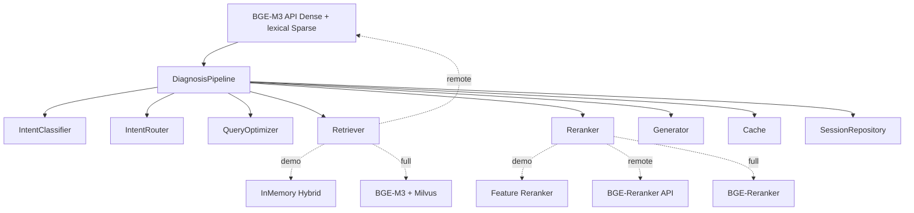
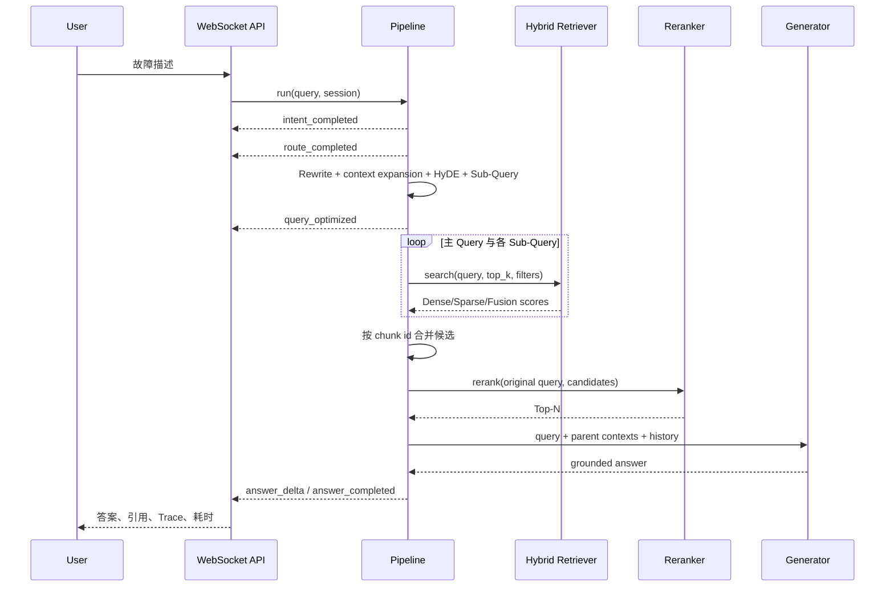

# FiberMind 架构说明

## 设计边界

系统分为领域层、应用服务层和基础设施层。`DiagnosisPipeline` 只依赖对象能力，不直接创建
Redis、Milvus 或模型，因此 demo 与真实后端共用一条编排逻辑。`Container` 是唯一的装配点。

## 一次复杂诊断的时序

## 关键实现选择

### 父子块索引

子块约 180 个字符，用于提高局部匹配；每个子块保存 `parent_id` 和完整父文档。召回后按
父文档去重，生成时使用完整流程，避免只取到半个操作步骤。

### 混合检索

demo baseline 使用字符/二元词特征模拟语义相似度，并计算词项覆盖率；二者按配置权重融合，
告警码精确命中额外加权。full backend 使用 BGE-M3 同时生成 1024 维 Dense Vector 和 Sparse
Lexical Weights，再调用 Milvus Hybrid Search。

baseline 的意义是离线可复现和接口验证，不等价于 BGE-M3 的真实效果。演示页和返回字段会
如实显示当前后端模式。

`bge_api` 是无需本地 Torch 的中间形态：Dense 使用远程 BGE-M3，Sparse 使用本地词法分量，
精排使用远程 BGE-Reranker。远程 embedding 协议不返回 lexical weights，因此只有 `milvus`
路径属于 BGE-M3 原生 Dense/Sparse；代码和报告明确区分两者。

### 二阶段精排

第一阶段以较低成本召回 Top-K；第二阶段只对少量候选做 Query-Document 交叉编码。这样避免
对全库运行 Cross Encoder。demo 使用标题、元数据、告警码和初排分数的可解释组合；full
backend 使用 `BAAI/bge-reranker-v2-m3`。

### 缓存策略

缓存键由标准化 Query 的 SHA-256 摘要构成，并带版本前缀。标准答案和知识问答可缓存；复杂
故障诊断默认不缓存最终答案，避免把特定现场结论复用到另一现场。生产中知识版本发布后提升
键版本或批量失效。

### 幻觉控制

- 生成输入只包含经过精排的知识父文档。
- 没有足够相关上下文时返回澄清问题。
- 回答区分可能原因和排查步骤，并返回来源及四类检索分数。
- 标准操作包含安全边界，例如不能直视光纤端面、不能盲目拔插在用线路。
- OpenAI-compatible Prompt 明确要求证据不足时拒答并使用引用编号。

## 可继续演进

- 用真实脱敏工单替换合成意图数据，增加对抗样本并报告 Macro-F1。
- 为 Query Rewrite 增加结构化 JSON 输出校验，保护告警码和指标值。
- 增加知识版本表、增量索引任务和按租户隔离。
- 通过 OpenTelemetry 输出 span，并将离线失败样例加入回归集。
- 对不同 Chunk、Top-K、融合权重做配置化实验并保存评测运行元数据。
