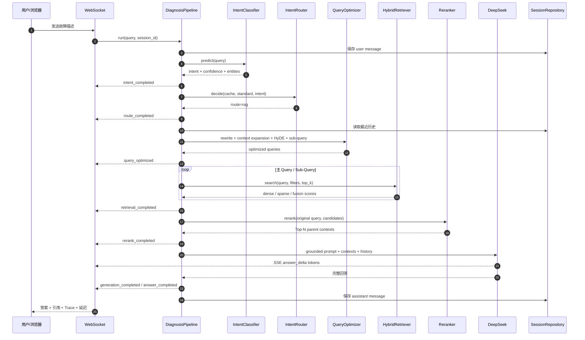
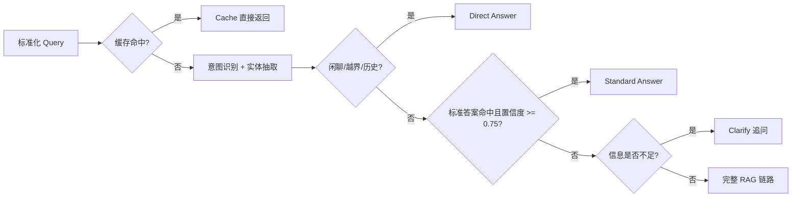

# FiberMind 项目阅读地图与架构图

这份文档回答三个问题：代码从哪里启动、一次 Query 如何流转、每个目录为什么存在。
推荐面试前先看“总架构”，再按“阅读路线”打开代码。

## 1. 一张图看懂系统

```mermaid
flowchart TB
    subgraph Client[客户端]
        UI[static 演示控制台]
        REST[REST Client / Swagger]
    end

    subgraph API[接口层 app/api]
        HTTP[POST /chat /diagnose]
        WS[WS /ws/chat/{session_id}]
    end

    subgraph App[应用服务层 app/services]
        P[DiagnosisPipeline<br/>统一编排]
        I[IntentClassifier<br/>Rule / BERT]
        R[IntentRouter<br/>Cache / Standard / RAG]
        O[QueryOptimizer<br/>Rewrite / HyDE / Sub-Query]
        H[Retriever<br/>Dense + Sparse Hybrid]
        X[Reranker<br/>Top-K -> Top-N]
        G[Generator<br/>Grounded / DeepSeek]
    end

    subgraph Infra[基础设施层 app/infrastructure]
        C[(Memory / Redis Cache)]
        S[(Memory / MySQL Session)]
        K[(JSON Knowledge / Standard Answers)]
        M[(Memory / Milvus)]
        B[Local / BGE-Reranker]
    end

    UI --> WS
    REST --> HTTP
    HTTP --> P
    WS --> P
    P --> I --> R
    R --> C
    R --> K
    R --> O --> H --> M
    H --> X --> B
    X --> G
    P --> S
    G --> UI
    G --> REST
```

当前 `.env` 使用实线左侧的轻量实现：`Rule + Memory + Local + DeepSeek`。将配置切换后，
同一个 `DiagnosisPipeline` 会使用 `BERT + Redis + MySQL + Milvus + BGE-Reranker`，业务层不改。

## 2. 一次复杂 Query 的时序图



## 3. 路由决策图



设计重点是让简单问题不必经过昂贵的检索和 LLM；复杂、长尾、带多个条件的问题才进入完整
RAG。故障诊断的最终答案默认不写入缓存，避免不同现场复用特定结论。

## 4. 代码阅读地图

### 第一圈：启动和装配

| 文件 | 读什么 | 面试表达 |
| --- | --- | --- |
| `app/main.py` | FastAPI、lifespan、静态页、WebSocket 注册 | 服务如何启动，为什么依赖在启动阶段装配 |
| `app/config.py` | 环境变量、校验、DeepSeek 默认配置 | 配置如何隔离，为什么 Key 不进代码 |
| `app/container.py` | 根据配置选择各实现 | demo 与生产后端如何共用业务代码 |
| `app/domain/models.py` | Intent、Route、Chunk、Trace 等领域对象 | 为什么传输层和领域层分离 |
| `app/schemas/api.py` | API 输入/输出校验 | 外部协议如何稳定，字段如何约束 |

### 第二圈：核心业务链路

| 文件 | 读什么 | 面试表达 |
| --- | --- | --- |
| `app/services/pipeline.py` | 一次请求的完整编排和事件流 | 从 Query 到答案的主线、耗时和可观测性 |
| `app/services/intent.py` | Rule fallback、BERT 推理、实体抽取 | 低依赖演示如何切到微调 BERT |
| `app/services/router.py` | Cache/Standard/RAG/Clarify 决策 | 为什么不能所有请求都调 LLM |
| `app/services/query_optimizer.py` | 术语归一化、HyDE、Sub-Query | 复杂口语 Query 如何变成可检索 Query |
| `app/services/chunking.py` | 父子块切分和 parent_id | 为什么召回子块、生成用父文档 |
| `app/services/retrieval.py` | 本地 Dense/Sparse baseline | 混合检索的分数和可解释 fallback |
| `app/services/generation.py` | Grounded 模板、DeepSeek/OpenAI、SSE | 证据约束、防幻觉和真正流式输出 |

### 第三圈：基础设施替换点

| 文件 | 读什么 | 面试表达 |
| --- | --- | --- |
| `app/infrastructure/knowledge.py` | 知识文档和标准答案 JSON 仓库 | 高频确定性问答如何绕过 LLM |
| `app/infrastructure/cache.py` | MemoryTTLCache、RedisCache | TTL、命中率、缓存键版本 |
| `app/infrastructure/sessions.py` | 内存会话仓库 | 测试和 demo 的最小持久化契约 |
| `app/infrastructure/mysql.py` | SQLAlchemy + MySQL 会话 | 同步驱动如何隔离，接口如何保持一致 |
| `app/infrastructure/milvus.py` | BGE-M3 Dense/Sparse、Milvus Hybrid Search | 向量字段、索引、WeightedRanker |
| `app/infrastructure/bge.py` | BGE-Reranker Cross Encoder | 为什么只对 Top-K 做二阶段精排 |

### 第四圈：接口和演示

| 文件 | 读什么 | 面试表达 |
| --- | --- | --- |
| `app/api/routes.py` | REST、健康检查、指标、WebSocket 事件 | API 契约和流式事件协议 |
| `app/static/index.html` | 三栏诊断控制台结构 | 为什么演示页要显示路由和来源 |
| `app/static/styles.css` | 桌面三栏、移动端断点、Trace 时间线 | 可用性而非堆视觉效果 |
| `app/static/app.js` | WebSocket 消费、Trace、引用和状态 | 前端只呈现后端事实，不重复计算 |

### 第五圈：离线工程

| 文件 | 读什么 | 面试表达 |
| --- | --- | --- |
| `data/knowledge.json` | 12 篇光网络父文档 | 领域知识如何建模，来源和版本如何保留 |
| `data/standard_answers.json` | LOS/LOF/光功率等标准答案 | 确定性问题为什么走 L2 |
| `scripts/generate_intent_dataset.py` | 固定 seed 生成 5000 条 Query | 数据字段、类别和合成数据的边界 |
| `scripts/train_intent_bert.py` | 分层切分、Trainer、标签保存 | BERT 微调流程和可复现性 |
| `evaluation/eval_dataset.json` | 检索回归集 | 失败样例如何固定下来 |
| `evaluation/run_evaluation.py` | 无 LLM 的快速 proxy 评测 | CI 为什么需要便宜、确定性的 smoke test |
| `evaluation/run_ragas.py` | RAGAS 真实评测入口 | Faithfulness、Relevancy、Recall 如何评估 |
| `evaluation/run_retrieval_sweep.py` | Chunk/Top-K/融合权重消融 | 参数选择如何保留可复现实验记录 |
| `reports/evaluation.*` | 最近一次评测结果 | 结果如何被审阅和比较 |

## 5. 配置与实现矩阵

| 能力 | 当前 `.env` | 生产/完整环境切换 |
| --- | --- | --- |
| 意图分类 | `rule` | `bert` + `models/intent-bert`（已训练验证） |
| 缓存 | `memory` | `redis` |
| 会话 | `memory` | `mysql` |
| 检索 | `memory` | `milvus` + BGE-M3 |
| 精排 | `local` | `bge` 本地模型或 `bge_api` 远程模型 |
| 生成 | `deepseek` | DeepSeek / OpenAI-compatible |

切换只需改 `.env` 和安装对应 extra，Pipeline、API、前端、测试契约不变。

## 6. 面试演示路线

```text
1. 打开首页，展示健康状态为 deepseek。
2. 输入“LOS是什么意思？”：说明标准答案路径。
3. 再输入同一句：说明 Cache 命中和低延迟。
4. 输入“ONU频繁闪断 + -29 dBm + LOS”：展开右侧 Trace。
5. 指出 Rewrite、Sub-Query、Hybrid、Rerank、Citation。
6. 继续问“那应该先检查哪里？”：展示会话上下文补全。
7. 打开 /metrics：解释路由统计、缓存命中和知识块数量。
8. 最后说明 demo baseline 与 BGE/Milvus/Redis/MySQL 的替换边界。
```

## 7. 安全边界

- 真实 Key 只存在本机 `.env`，该文件被 `.gitignore` 排除。
- 不要把 Key 放入 README、截图、浏览器前端、Dockerfile 或 Git 提交。
- 如果 Key 曾经公开发到不受信任的地方，应在 DeepSeek 控制台撤销并重新生成。
- 演示时可展示 `services.llm=deepseek`，不要展示 Key 的值。
